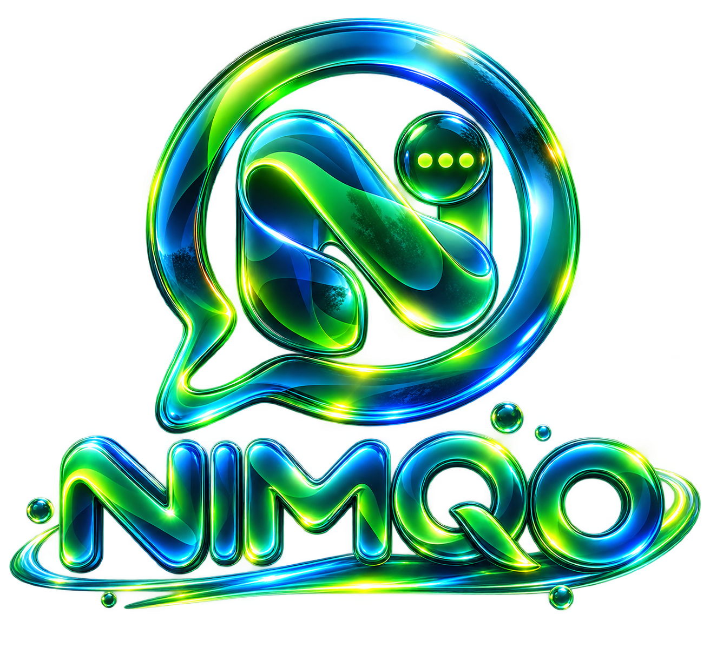
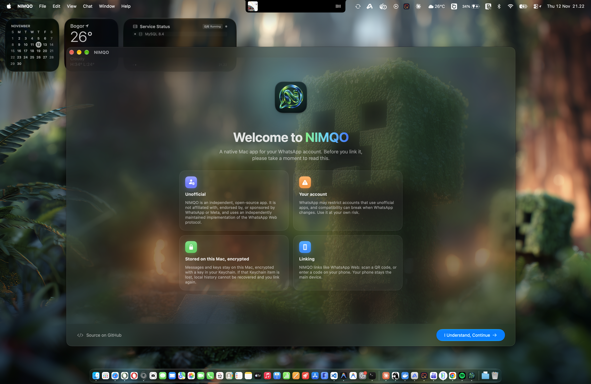
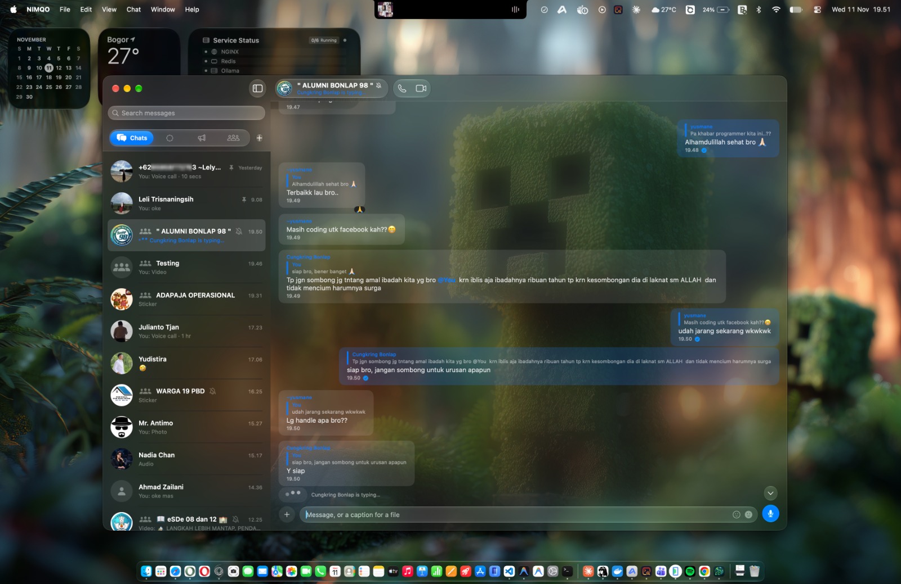
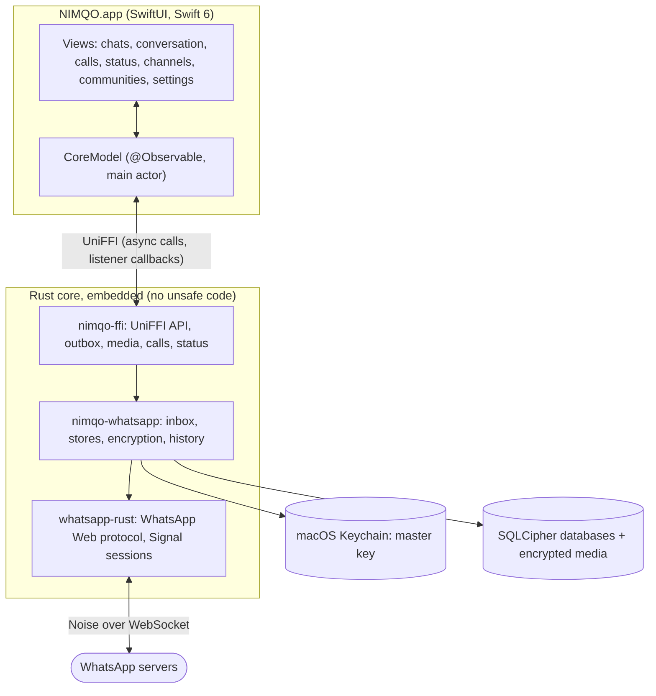

<p align="center">
  
</p>

<h3 align="center">A WhatsApp client, designed for the Mac.</h3>

<p align="center">
  Native SwiftUI on top of a memory-safe Rust core. Encrypted on disk from the first run.<br>
  No Electron, no web view, no telemetry.
</p>

<p align="center">
  
  
  
  
  <a href="LICENSE"></a>
</p>

<p align="center">
  <a href="https://sonarcloud.io/summary/overall?id=wprimadi_nimqo"></a>
  <a href="https://sonarcloud.io/summary/overall?id=wprimadi_nimqo"></a>
  <a href="https://sonarcloud.io/summary/overall?id=wprimadi_nimqo"></a>
  <a href="https://sonarcloud.io/summary/overall?id=wprimadi_nimqo"></a>
</p>

<p align="center">
  
  <br>
  <sub><b>First launch.</b> What using an unofficial client means, before anything connects.</sub>
</p>

<p align="center">
  
  <br>
  <sub><b>Every day.</b> Your chats in a native Mac window, on glass.</sub>
</p>

> [!WARNING]
> **NIMQO is unofficial.** It is an independent, open-source app that is not
> affiliated with, endorsed by, or sponsored by WhatsApp or Meta. It speaks the
> WhatsApp Web protocol through an independently maintained implementation, so
> it can break whenever WhatsApp changes, and using an unofficial client may
> violate Meta's terms and lead to account restrictions. **Use it at your own
> risk**, ideally with an account you can afford to lose until you accept that.

---

## Contents

- [Why NIMQO](#why-nimqo)
- [What it does today](#what-it-does-today)
- [Keyboard shortcuts](#keyboard-shortcuts)
- [Privacy and security](#privacy-and-security)
- [Requirements](#requirements)
- [Download and install](#download-and-install)
- [Build and run](#build-and-run)
- [Linking your account](#linking-your-account)
- [Architecture](#architecture)
- [Repository layout](#repository-layout)
- [Development](#development)
- [Roadmap and known limits](#roadmap-and-known-limits)
- [Documentation](#documentation)
- [Contributing, security, and conduct](#contributing-security-and-conduct)
- [Acknowledgements](#acknowledgements)
- [Author](#author)
- [License](#license)

## Why NIMQO

The official desktop apps are web views in a window. NIMQO is the other
approach: an app written for macOS from the first line, that behaves the way a
Mac app is expected to, with Liquid Glass, the menu bar, real keyboard
shortcuts, VoiceOver, Reduce Motion, and the system's own panels.

It is built to one standard:

> *Every interaction should feel intentional. Every animation should have a
> purpose. Every detail should make the experience better.*

In practice that means:

- **Native, not wrapped.** SwiftUI and AppKit for everything you see; the
  protocol, storage, and crypto live in a Rust core embedded in the app.
- **Private by construction.** Every byte NIMQO stores is encrypted with a key
  held in your Keychain. There is no plaintext mode and no fallback.
- **Motion with meaning.** Photos grow out of their bubble and shrink back
  into it; a quoted reply scrolls to its original and marks it. Everything
  respects Reduce Motion and Reduce Transparency.
- **No telemetry.** NIMQO talks to WhatsApp's servers and nothing else.

## What it does today

NIMQO links to your account as a companion device, like WhatsApp Web, and
works with every chat, group, community, and channel.

### Chats and messages

- Chat list with names, previews, times, unread counts, typing, muted and
  disappearing-message indicators. **Pin** up to three chats, **archive**
  chats, and mute them; all of it syncs with your phone.
- Send and receive text, with **Return** to send and **Shift-Return** or
  **Option-Return** for a new line.
- **Replies**: quote any message; click a quote to jump to the original,
  loading older history if needed, and see it highlighted.
- **Reactions**: six quick reactions, or any emoji from the macOS Character
  Viewer. Hover a message for its React and menu buttons.
- **Edit** your messages within 15 minutes (↑ edits the last one), **delete
  for everyone** within WhatsApp's window, or **delete for me** on all your
  devices. **Star** messages and find them again under Starred Messages.
- **Forward** to up to five chats at once.
- **Message Info** for your own messages: who it was delivered to and who
  read or played it, with the time and their profile picture.
- **Polls**: create one from the composer (one answer or several), vote, and
  see the count live; votes from before linking are counted too.
- **Locations and contact cards** are drawn as cards; a contact opens its chat.
- **Messages with buttons** from businesses and bots (buttons, templates,
  lists, and interactive messages) show their buttons inside the bubble:
  quick replies answer, links open, codes copy, and lists open as a menu.
- **Mentions** show people's names, not numbers or LIDs, also in quotes and
  in the chat list.
- **Links** are clickable (`http`, `https`, and `mailto` only), with the
  preview the sender attached. Making previews for your own links is a
  Settings switch, off by default.
- **New Chat** (⌘N): pick a contact or type any number with its country code;
  NIMQO checks it is on WhatsApp before the chat opens.
- **Search** across stored messages, with the hit revealed in its chat.
- Read receipts sent as you read (unless turned off in your privacy settings);
  delivery and read ticks on your messages; failed sends can be retried.
- A contact's about text, online status, last seen, and typing indicator in
  the chat header, and a profile card with starred messages, notifications,
  and disappearing messages.
- View-once media is never stored, so it cannot be forwarded or reopened.

### Media

- Photos, videos, voice notes and audio, documents, and stickers (static,
  GIF, and animated Lottie). GIFs loop on their own in the timeline, muted.
- **Voice messages**: record and send from the composer; they play back with
  a waveform, a speed control, and seeking.
- **Stickers and GIFs**: a picker with your favourites from the phone, the
  recent ones, and the stickers and GIFs seen in your chats.
- Send photos, videos, audio, and documents by picker or **drag and drop**
  anywhere on a chat; photos are re-encoded as JPEG, which also strips
  location and other metadata.
- A full-window viewer for photos and videos with zoom, pan, and
  drag-to-dismiss, with **Save As…** and **Share**. Documents open in
  Quick Look.
- Old media that WhatsApp's servers no longer hold is asked for again from
  your phone.

### Groups, communities, channels, and status

- Group info: subject, description, members, and their roles.
- **Group admin**: edit the name and description, change the group's
  settings, add, remove, promote, and demote members, copy or reset the
  invite link, delete members' messages, and leave. Create a **New Group**
  (⌘⇧N).
- **Communities**: see your communities and their groups, and open or join
  a group.
- **Channels** you follow, with their posts and media (read-only); new posts
  appear as they arrive.
- **Status**: a full-window player with auto-advance, and posting text or a
  photo with a caption to the audience set in your phone's status privacy.
  A Settings switch decides whether posters see you in their viewers.

### Calls

- **Voice and video calls**, one-to-one and in groups, from the phone and
  camera buttons in the chat header. Group calls show a grid of
  participants. Incoming calls ring in a small window that floats over other
  apps until you click Accept or Decline (Esc declines).
- Mute, camera on and off mid-call, **share a window or your screen**, and
  see a phone's shared screen. Closing the window hangs up.
- Echo cancellation from macOS's own voice processing; video is H.264
  encoded and decoded in hardware.
- Calls appear in the chat's timeline, and calls missed while NIMQO could not
  answer raise a notification.

### Your account

- **Profile**: change your picture, name, and About.
- **Linking** by QR code or by an eight-character pairing code, with Copy.

### The Mac around it

- **Menu bar popover** with connection status, the latest chats, search, and
  a reply field, on every desktop.
- Notifications you can **reply to** (when the Mac is unlocked), and a Dock
  badge for unread messages.
- **Open at Login**, as a Settings switch.
- Closing the window keeps NIMQO connected; the Dock icon or the menu bar
  brings it back. A second launch brings the running app forward.
- **Settings** (⌘,), in panes: General (Open at Login, link previews),
  Privacy (your WhatsApp privacy settings: last seen, online, profile photo,
  about, groups, read receipts; and status view receipts), and Appearance
  (the window's **glass**: Clear, Dark, or Light, with an opacity slider from
  see-through to solid).
- Light on resources: pictures are decoded at the size they are shown,
  rows redraw only when their message changes, and voice notes redraw only
  while they play.

## Keyboard shortcuts

| Shortcut | Action |
| --- | --- |
| ⌘N | New Chat |
| ⌘⇧N | New Group |
| ⌘F | Search messages |
| ⌥⌘S | Starred messages |
| ⌘1 … ⌘9 | Open one of the nine most recent chats |
| ⌃Tab / ⌃⇧Tab | Next / previous chat |
| ⌘⇧A | Attach a photo or file |
| Return | Send |
| ⇧Return, ⌥Return | New line |
| ⌘Return | Send (from anywhere in the composer) |
| ↑ (empty composer) | Edit your last message |
| ⌘↓ | Jump to the latest message |
| ⌘S | Save the open photo or video |
| Esc | Close the viewer, a sheet, or a menu |
| ⌘⇧M / ⌘⇧V | Mute / camera, during a call |
| ⌘, | Settings |

## Privacy and security

- **Encryption at rest, always.** A 256-bit master key comes from the system
  CSPRNG and lives in the macOS Keychain as a device-only, non-synchronizable
  item. HKDF derives separate keys for the protocol database, the app
  database, and media. Both databases are SQLCipher; every media file is
  sealed with its own key using ChaCha20-Poly1305 in the STREAM construction
  ([ADR 0004](docs/ADR/0004-encryption-and-key-management.md),
  [ADR 0006](docs/ADR/0006-media-encryption-format.md)).
- **Fails closed.** If the key is missing, NIMQO does not start with an empty
  or plaintext store. Losing the Keychain item means linking again.
- **Log Out and Remove Data** destroys the keys first, then the files.
- **Your privacy settings are respected exactly.** Status posts go only to
  the audience your phone defines; anything NIMQO cannot match is not sent.
- **No telemetry, no analytics, no third-party services.** Logs carry no
  message content or phone numbers.
- Data lives in `~/Library/Application Support/NIMQO-dev`, readable only by
  your user.

Found a vulnerability? Please report it privately as described in
[SECURITY.md](SECURITY.md), never in a public issue.

## Requirements

| | |
| --- | --- |
| **Run** | macOS 14 Sonoma or later, on Apple silicon or Intel. Liquid Glass appears on macOS 26 and later. |
| **Build** | Xcode 26 or later, Rust 1.95 or later, [XcodeGen](https://github.com/yonaskolb/XcodeGen) |
| **Push** | gitleaks, cargo-audit, cargo-deny, SwiftLint, SwiftFormat (the local quality gate) |

## Download and install

Ready-made disk images are on the
[Releases page](https://github.com/wprimadi/nimqo/releases):

| File | For |
| --- | --- |
| `NIMQO-<version>-apple-silicon.dmg` | Macs with an M-series chip (smaller download) |
| `NIMQO-<version>-universal.dmg` | Any Mac, Apple silicon or Intel |

Not sure which Mac you have? Apple menu → **About This Mac**: "Chip: Apple M…"
is Apple silicon, "Processor: Intel…" is Intel. The universal one works on both.

1. Download the disk image and open it.
2. Drag **NIMQO** onto **Applications**, then eject the disk image.
3. Open Terminal and run, once:

   ```sh
   xattr -cr /Applications/NIMQO.app
   ```

4. Open NIMQO from Applications or Launchpad, and scan the QR code with
   WhatsApp on your phone (see [Linking your account](#linking-your-account)).

**Why `xattr -cr`?** Your browser marks every downloaded file with a
`com.apple.quarantine` attribute. Gatekeeper checks marked apps for an Apple
Developer ID and a notarisation ticket; NIMQO has neither (it is signed with
the maintainer's own certificate, see [Code signing](#code-signing)), so
without this step macOS says the app "is damaged" or "can't be opened".
`xattr` edits a file's extended attributes: `-c` clears them all, `-r` does so
for every file inside the app bundle. It changes nothing else, and only for
this one app; Gatekeeper stays on for everything else. To check first that the
copy is genuine, compare its certificate as shown in
[Code signing](#code-signing).

Prefer not to use Terminal? Open the app once, dismiss the warning, then go to
**System Settings → Privacy & Security** and click **Open Anyway** next to
NIMQO. If macOS only offers to move it to the Trash, use `xattr` instead.

To update, quit NIMQO, drag the new version onto Applications to replace the
old one, and run `xattr -cr` again. Your chats and the linked account stay.

## Build and run

Or build it from source:

```sh
git clone https://github.com/wprimadi/nimqo.git
cd nimqo
brew install xcodegen
make run
```

| Make target | What it does |
| --- | --- |
| `make run` | Builds the app (Debug) and opens it |
| `make build` | Builds the app; `make build CONFIG=Release` for an optimised one |
| `make dmg` | Builds Release disk images for all three below, in `dist/` |
| `make dmg-silicon` | `dist/NIMQO-<version>-apple-silicon.dmg`, for Apple silicon |
| `make dmg-intel` | `dist/NIMQO-<version>-intel.dmg`, for Intel Macs |
| `make dmg-universal` | `dist/NIMQO-<version>-universal.dmg`, one app for both |
| `make test` | Builds and runs the app's unit tests |
| `make clean` | Removes the app build, the generated core, and `dist/` |

The targets call the scripts below, which build the Rust core, generate the
Xcode project from [`app/project.yml`](app/project.yml), and build the app
(for Apple silicon unless `ARCHS` says otherwise: `x86_64`, or
`"arm64 x86_64"` for a universal app):

| Script | What it does |
| --- | --- |
| `scripts/build-core.sh` | Builds the Rust core and its Swift bindings (UniFFI) into `app/Generated` |
| `scripts/build-app.sh` | Builds the core, then the app (`app/build/.../NIMQO.app`) |
| `scripts/build-app.sh test` | The same, then runs the app's unit tests |
| `scripts/run-app.sh` | Builds and opens the app |
| `scripts/make-icon.swift` | Rebuilds the app icon from `Logo/nimqo.png` |

### Code signing

NIMQO releases are signed with the maintainer's own self-signed certificate,
not an Apple Developer ID, so macOS does not recognise the developer.

**Installing a release.** Run `xattr -cr /Applications/NIMQO.app` once after
each install; [Download and install](#download-and-install) explains why.

**Keychain access.** At first launch macOS asks for your login password so
NIMQO can read its key; choose **Always Allow** and that copy of the app opens
without asking. Without an Apple Developer ID, macOS ties Keychain access to
the exact build rather than the certificate, so each update asks once more.
Microphone and camera answers follow the certificate and are kept across
updates.

**Checking a release.** A genuine release reports this certificate:

```sh
codesign -dr - /Applications/NIMQO.app
# … certificate leaf = H"17bd502dbbdca6685eae53608e3113d4f13a4bc5"
```

**Building it yourself.** Your build is signed ad hoc. That runs fine on your
Mac, but every rebuild is a new app to macOS, which asks for Keychain access
again (with the maintainer's certificate, too: see Keychain access above). The maintainer keeps the certificate in `Secret/`, which is
git-ignored; `build-app.sh` signs with it when it is there.

### Logs

To follow the app's logs:

```sh
/usr/bin/log stream --predicate 'subsystem BEGINSWITH "app.nimqo"'
```

## Linking your account

1. Open NIMQO and read the first screen: it explains what an unofficial
   client means for your account.
2. On your phone, open WhatsApp → **Settings** → **Linked devices** →
   **Link a device**.
3. Scan the QR code NIMQO shows, or choose to link with a code and enter it
   on your phone.
4. Your chats arrive as your phone sends history. Your phone stays the main
   device; NIMQO is a companion, like WhatsApp Web.

To unlink, use **NIMQO → Log Out and Remove Data…**, or remove the device
from your phone.

## Architecture



- **The core is embedded**, not a daemon ([ADR 0003](docs/ADR/0003-embedded-core-vs-daemon.md)):
  one process, one lifecycle, no local socket to secure.
- **UniFFI** generates the Swift bindings
  ([ADR 0002](docs/ADR/0002-uniffi-boundary.md)); the Swift side calls async
  functions and receives events through a listener.
- **Sends go through an outbox**: a message is stored first, then sent, so a
  crash or a dropped connection never loses what you typed.
- **The app owns presentation; the core owns truth.** Names, unread counts,
  quotes, and who may receive a status are decided in Rust, where they are
  tested.

## Repository layout

```text
nimqo/
├── app/
│   ├── project.yml            XcodeGen spec (the .xcodeproj is generated)
│   ├── NIMQO/                 SwiftUI app: views, CoreModel, stores, assets
│   └── NIMQOTests/            Unit tests (no account needed)
├── rust/
│   └── crates/
│       ├── nimqo-ffi/         The API the app calls, via UniFFI
│       └── nimqo-whatsapp/    Storage, encryption, inbox, history, pairing
├── docs/
│   ├── ADR/                   Architecture decision records
│   └── UPSTREAM-COMPATIBILITY.md
├── scripts/                   Build, run, and icon scripts
├── Logo/                      The NIMQO mark and wordmarks
├── .githooks/pre-push         The local quality gate
└── plan.md                    Product, architecture, and development plan
```

## Development

Enable the quality gate once per clone. It runs on every push, and there is
no hosted CI, so it is the gate:

```sh
brew install gitleaks cargo-audit cargo-deny swiftlint swiftformat xcodegen
git config core.hooksPath .githooks
```

On every push it runs, in order:

1. **gitleaks** on the pushed commits.
2. **Rust:** `cargo fmt --check`, Clippy (pedantic, warnings as errors),
   `cargo test`, `cargo audit`, `cargo deny`.
3. **Swift:** SwiftFormat (lint) and SwiftLint (strict).
4. **App:** builds the app and runs its unit tests.

Never bypass it with `--no-verify`. Conventions:

- [Conventional Commits](https://www.conventionalcommits.org/), signed off for
  the [DCO](https://developercertificate.org/): `git commit -s`.
- Tests never need a real account or a secret; fixtures are synthetic.
- Never commit sessions, databases, keys, logs, or real conversations.
- Architectural changes need an ADR in [`docs/ADR`](docs/ADR).
- `nimqo-poc` (in `nimqo-whatsapp`) is the Phase 0 command-line proof of
  concept; it only talks to the number in `NIMQO_TEST_PEER`. Don't run it and
  the app at the same time: they share one linked device.

## Roadmap and known limits

**Next**

- A first public beta, signed and with release notes.
- GIF search, and making stickers from your own photos.

**Known limits today**

- Releases are not notarized, so each install needs `xattr -cr` (see
  [Download and install](#download-and-install)).
- Channels are read-only; you cannot post to or create one.
- Status: no video posts, no deleting your own update, and the "close
  friends" audience is not supported (NIMQO refuses rather than guess).
- History is what your phone sends at linking; older messages load from it
  page by page where it allows.
- Stickers to send are the ones you have seen or favourited; there is no
  sticker or GIF search yet.
- Message Info lists receipts that arrived after it was added; older
  messages show their tick only.

The full plan, with every phase and its exit criteria, is in
[`plan.md`](plan.md).

## Documentation

- [`plan.md`](plan.md): product, architecture, and development master plan.
- [`docs/ADR`](docs/ADR): why NIMQO is built the way it is, from the SwiftUI
  and Rust split to the media encryption format.
- [`docs/UPSTREAM-COMPATIBILITY.md`](docs/UPSTREAM-COMPATIBILITY.md): what has
  been verified against `whatsapp-rust`.
- [`THIRD-PARTY-NOTICES`](THIRD-PARTY-NOTICES): third-party code and assets.

## Contributing, security, and conduct

Contributions are welcome. Read [CONTRIBUTING.md](CONTRIBUTING.md) first, and
open an issue before larger changes. Report security issues privately through
[SECURITY.md](SECURITY.md). Participation is governed by the
[Code of Conduct](CODE_OF_CONDUCT.md).

## Acknowledgements

- [whatsapp-rust](https://github.com/oxidezap/whatsapp-rust): the WhatsApp Web
  protocol in Rust, which NIMQO is built on.
- [UniFFI](https://github.com/mozilla/uniffi-rs): the Rust and Swift bridge.
- [SQLCipher](https://www.zetetic.net/sqlcipher/): encrypted SQLite.
- [Lottie](https://github.com/airbnb/lottie-ios): animated stickers.
- [Opus](https://opus-codec.org): voice messages and call audio.
- [Simple Icons](https://simpleicons.org): the brand marks in the About window.

## Author

**Wahyu Primadi** · [wahyuprimadi.com](https://wahyuprimadi.com) ·
[saya@wahyuprimadi.com](mailto:saya@wahyuprimadi.com)

[GitHub](https://github.com/wprimadi) ·
[LinkedIn](https://www.linkedin.com/in/wahyuprimadi) ·
[Hack The Box](https://profile.hackthebox.com/profile/019f859a-988d-70d0-9355-d307aef7aa95) ·
[X](https://x.com/wprimadi) ·
[Instagram](https://www.instagram.com/wprimadi) ·
[YouTube](https://www.youtube.com/@wprimadi) ·
[Facebook](https://www.facebook.com/wahyuprimadi)

## License

NIMQO is released under the [MIT License](LICENSE). WhatsApp is a trademark of
WhatsApp LLC; NIMQO is not affiliated with it.
